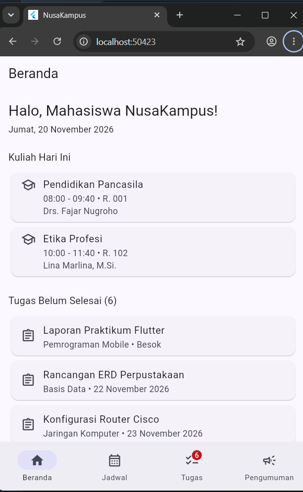
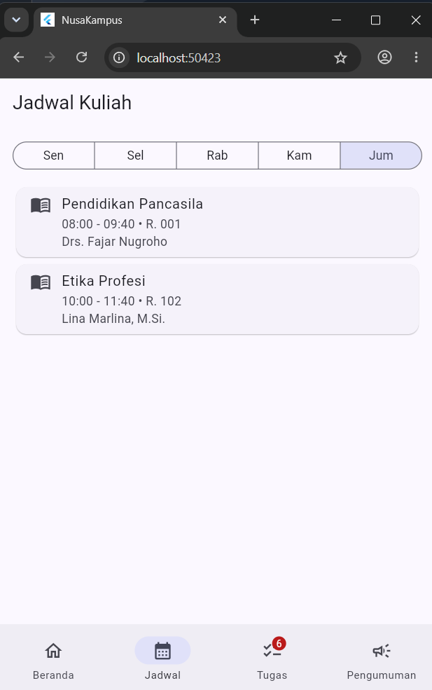
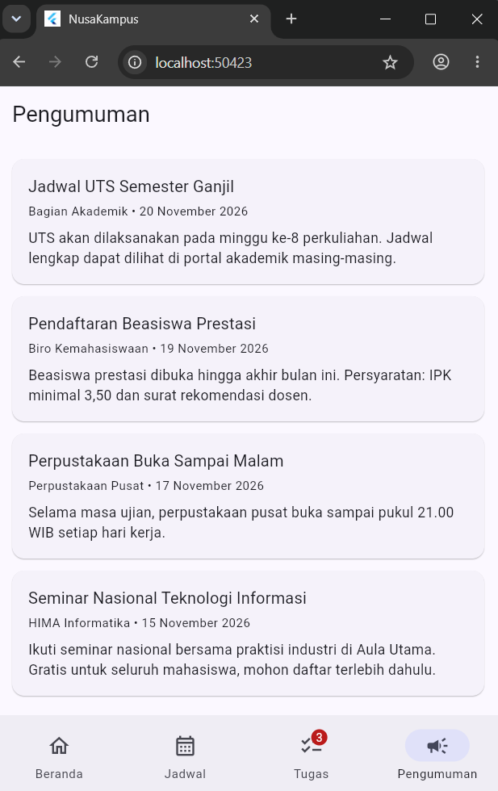
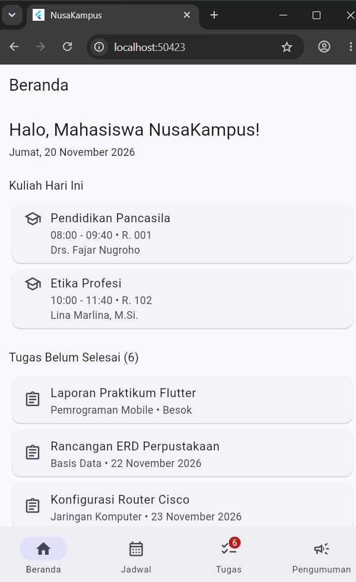
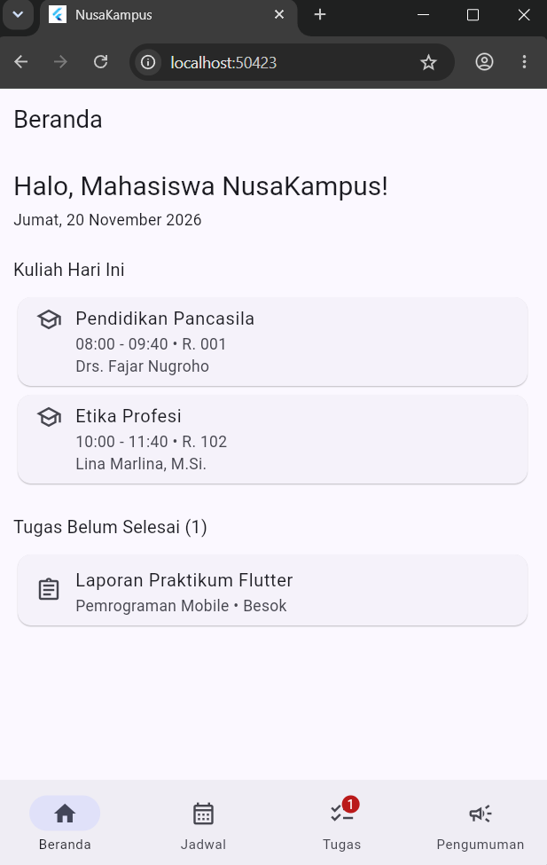
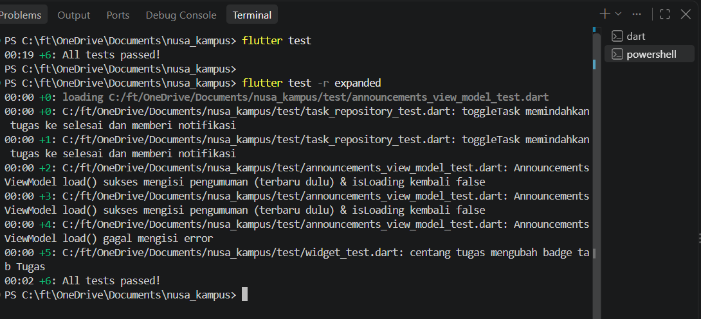

# NusaKampus

Aplikasi kampus sederhana (Flutter) dengan **arsitektur berlapis**
(View → ViewModel → Repository → Service) sesuai panduan resmi Flutter.

## Fitur
- **Beranda** – kuliah hari ini + tugas belum selesai (gabungan `ScheduleRepository` & `TaskRepository`)
- **Jadwal** – jadwal per hari dengan `SegmentedButton` (Senin–Jumat)
- **Tugas** – `CheckboxListTile`, tugas tercentang pindah ke bagian *Selesai*, badge di tab
- **Pengumuman** – daftar pengumuman dari `AnnouncementRepository`

## Struktur
```
lib/
├── main.dart / app.dart
├── config/dependencies.dart      # MultiProvider (service + repository)
├── domain/models/                # Course, Task, Announcement
├── data/services/                # CampusService (Future.delayed)
├── data/repositories/            # Schedule, Task (ChangeNotifier), Announcement
└── ui/ core | shell | home | schedule | tasks | announcements
```

## Menjalankan
```bash
flutter create .      # sekali saja, untuk membuat folder android/ios/web
flutter pub get
flutter run
flutter test
```

## Screenshot
| Beranda | Jadwal |
|---|---|
|  |  |

| Tugas | Pengumuman |
|---|---|
|  |  |

### Beranda sebelum & sesudah tugas dicentang
| Sebelum | Sesudah |
|---|---|
|  |  |

### Hasil `flutter test`

